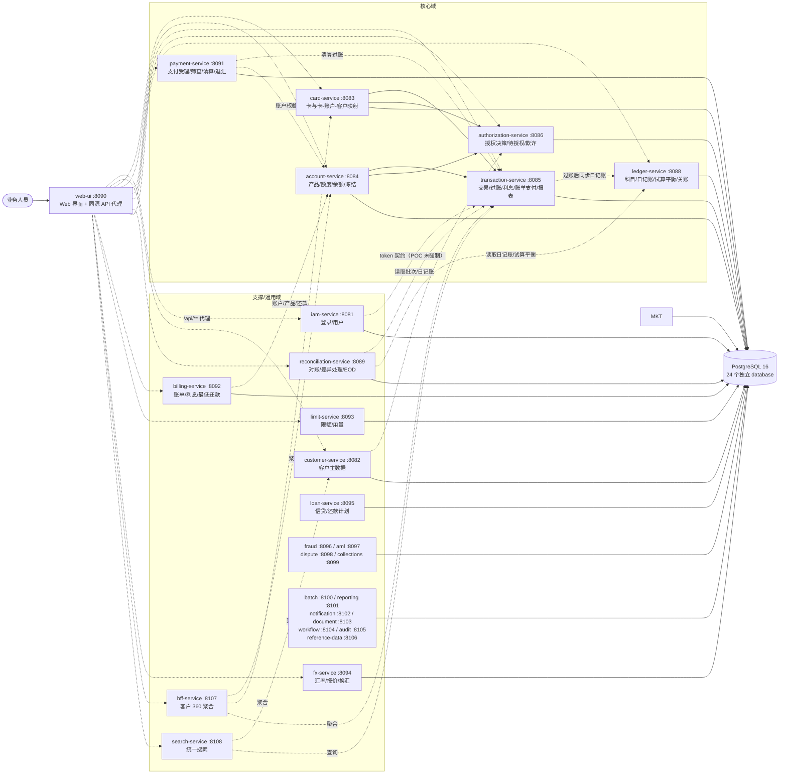

# CardDemo Java 微服务版（carddemo-java-1025）

面向信用卡核心业务的 Java 微服务工程，基于 **DDD 限界上下文**构建。
工程按领域边界拆分为 26 个微服务（6 个核心业务域 + 总账、对账、支付、账单、限额、汇率、信贷、风险、运营、渠道），用 Spring Boot 3 落地，并提供面向业务人员的 Web 界面与
Docker Compose 调试运行能力。

## 1. 架构总览



| 服务 | 端口 | 数据库 |
|---|---|---|
| web-ui | 8090 → 容器 8080 | —（静态 SPA + 代理） |
| iam-service | 8081 | `carddemo_iam` |
| customer-service | 8082 | `carddemo_customer` |
| card-service | 8083 | `carddemo_card` |
| account-service | 8084 | `carddemo_account` |
| transaction-service | 8085 | `carddemo_transaction` |
| ledger-service | 8088 | `carddemo_ledger` |
| reconciliation-service | 8089 | `carddemo_reconciliation` |
| payment-service | 8091 | `carddemo_payment` |
| billing-service | 8092 | `carddemo_billing` |
| limit-service | 8093 | `carddemo_limit` |
| fx-service | 8094 | `carddemo_fx` |
| loan-service | 8095 | `carddemo_loan` |
| fraud-service | 8096 | `carddemo_fraud` |
| aml-service | 8097 | `carddemo_aml` |
| dispute-service | 8098 | `carddemo_dispute` |
| collections-service | 8099 | `carddemo_collections` |
| batch-service | 8100 | `carddemo_batch` |
| reporting-service | 8101 | `carddemo_reporting` |
| notification-service | 8102 | `carddemo_notification` |
| document-service | 8103 | `carddemo_document` |
| workflow-service | 8104 | `carddemo_workflow` |
| audit-service | 8105 | `carddemo_audit` |
| reference-data-service | 8106 | `carddemo_reference` |
| bff-service | 8107 | —（无状态） |
| search-service | 8108 | —（无状态） |
| authorization-service | 8086 | `carddemo_authorization` |

## 2. 目录结构

```
carddemo-java-1025/
├── pom.xml                      # Maven 聚合父 POM（Spring Boot 3.3.6 / Java 21）
├── docker-compose.yml           # PostgreSQL + 14 个默认微服务 + Web 界面；extended profile 追加 12 个
├── docker/postgres/init/        # 24 个 database 初始化
├── scripts/build-and-up.sh      # 打包 + 构建镜像 + 启动
├── scripts/smoke-test.sh        # 端到端冒烟测试
├── docs/
│   ├── design/                  # DDD 设计：服务拆分、API、钱路径、蓝图、ADR
│   └── ops/                     # Docker 运行与调试手册
└── services/
    ├── iam-service/
    ├── customer-service/
    ├── card-service/
    ├── account-service/
    ├── transaction-service/
    ├── ledger-service/           # 总账：科目/日记账/试算平衡/关账（新增）
    ├── reconciliation-service/   # 对账/EOD：批次↔日记账、差异处理（新增）
    ├── payment-service/          # 支付：受理/筛查/清算/退汇（新增）
    ├── billing-service/          # 账单：生成/利息/最低还款/支付（新增）
    ├── limit-service/            # 限额：额度/用量/校验（新增）
    ├── fx-service/               # 汇率：报价/换汇（新增）
    ├── loan-service/             # 信贷：申请/审批/放款/还款（新增）
    ├── fraud-service/            # 欺诈评分/警报（新增）
    ├── aml-service/              # 制裁筛查/AML 警报（新增）
    ├── dispute-service/          # 争议/chargeback（新增）
    ├── collections-service/      # 逾期/催收（新增）
    ├── batch-service/            # 批处理/EOD（新增）
    ├── reporting-service/        # 报表（新增）
    ├── notification-service/     # 通知（新增）
    ├── document-service/         # 文档（新增）
    ├── workflow-service/         # 工作流（新增）
    ├── audit-service/            # 审计（新增）
    ├── reference-data-service/   # 参考数据（新增）
    ├── bff-service/              # 客户 360 聚合（新增）
    ├── search-service/           # 统一搜索（新增）
    ├── authorization-service/
    └── web-ui/                  # 业务界面（静态 SPA）+ 同源 API 代理
```

除 `web-ui` 外，每个 Java 微服务采用同一分层：

```
src/main/java/com/carddemo/<context>/
├── interfaces/rest   # Controller + DTO
├── application       # 用例编排、事务边界
├── domain            # 聚合根、领域服务、仓储端口、异常
└── infrastructure    # JPA 适配器、下游 REST 客户端、配置
```

## 3. 快速开始

前置：JDK 21、Maven 3.9+、Docker + Compose v2。

```bash
cd carddemo-java-1025
./scripts/build-and-up.sh          # mvn package + docker compose up -d --build
docker compose ps
./scripts/smoke-test.sh            # 端到端验证（健康、查询、过账、冻结、授权、报表、支付、对账、BFF）
```

打开 **http://localhost:8090/** 即为业务界面（登录账号已预填，直接登录）。

> 当前环境的 Docker Hub 不可达，镜像基于本机已有的 `eclipse-temurin:21.0.8_9-jdk` 与
> `postgres:16-alpine` 构建，因此镜像构建前必须先在宿主机执行 `mvn package`（脚本已包含）。
> 如果你的网络可访问 Docker Hub，可将各服务 `Dockerfile` 的首行改为 `eclipse-temurin:21-jre`
> 并恢复多阶段构建。

全部单元/集成测试：

```bash
mvn test        # 762 个用例，H2 + Flyway，多模块并行
```

## 3.1 Web 界面（推荐）

打开 **http://localhost:8090/**（宿主机 8080 已被其他程序占用，故映射到 8090；容器内仍为 8080）。

| 页面 | 能力 |
|---|---|
| 登录 | 账号已预填，管理员/普通用户切换 |
| 首页 | 按角色展示可用功能入口 |
| 账户视图 | 账户 + 客户 + 卡片组合展示、产品/额度/冻结/可用额度、创建与释放 hold |
| 过账 | 过账类型、幂等批次、借贷分录、冲正（钱路径新增） |
| 总账 | 科目表、日记账、试算平衡、期间关账、手工记账（钱路径新增） |
| 对账与 EOD | 按日对账、差异明细与处理、EOD 作业历史（管理员，钱路径新增） |
| 支付 | 创建支付、筛查、接受、清算、退汇（P2 新增） |
| 账单 | 生成账单、查看利息/最低还款/到期日、全额支付（P2 新增） |
| 限额 | 创建/调整限额、占用/释放、可用性检查（管理员，P2 新增） |
| 汇率 | 汇率维护、报价、执行换汇、换汇记录（P2 新增） |
| 客户 360 | BFF 聚合账户/卡片/客户/交易/权益，统一搜索（P5 新增） |
| 贷款 | 申请、审批/拒绝、放款、还款计划、还款（P3 新增） |
| 风险 | 欺诈评分/警报、AML 筛查/警报、争议、催收（P3 新增） |
| 运营 | 批处理、报表、通知、文档、工作流、审计、参考数据（P4 新增） |
| 信用卡 | 按账户/客户筛选、分页、详情与维护（卡面名/状态/到期） |
| 交易查询 | 交易号前缀/卡号/账户过滤、分页、详情 |
| 交易录入 | 类型/类别联动选择、完整商户信息、自动生成交易号 |
| 账单支付 | 查询欠款 → 确认 → 全额还款并回显新余额 |
| 交易报表 | 日期区间统计、区间合计、按卡合计 |
| 授权管理 | 待授权汇总、明细、标记欺诈、过期清理 |
| 用户管理 | 列表、新增、编辑、删除（仅管理员） |

| 演示账号 | 密码 | 类型 |
|---|---|---|
| `ADMIN001` | `admin123` | 管理员（已预填） |
| `USER0001` | `user1234` | 普通用户 |

前端为无构建依赖的原生 SPA（`services/web-ui/src/main/resources/static`），所有 `/api/**` 请求由
web-ui 同源代理到对应微服务，浏览器无需处理 CORS。界面不做敏感信息展示：卡号完整显示仅用于演示，
SSN 始终为掩码，CVV 不返回。

## 3.2 API 控制台（Swagger UI）

每个微服务的根路径会 302 到自己的 Swagger UI，可用于接口调试：

| 服务 | Swagger UI | OpenAPI |
|---|---|---|
| iam | http://localhost:8081/ | http://localhost:8081/v3/api-docs |
| customer | http://localhost:8082/ | http://localhost:8082/v3/api-docs |
| card | http://localhost:8083/ | http://localhost:8083/v3/api-docs |
| account | http://localhost:8084/ | http://localhost:8084/v3/api-docs |
| transaction | http://localhost:8085/ | http://localhost:8085/v3/api-docs |
| ledger | http://localhost:8088/ | http://localhost:8088/v3/api-docs |
| reconciliation | http://localhost:8089/ | http://localhost:8089/v3/api-docs |
| payment | http://localhost:8091/ | http://localhost:8091/v3/api-docs |
| billing | http://localhost:8092/ | http://localhost:8092/v3/api-docs |
| limit | http://localhost:8093/ | http://localhost:8093/v3/api-docs |
| fx | http://localhost:8094/ | http://localhost:8094/v3/api-docs |
| loan | http://localhost:8095/ | http://localhost:8095/v3/api-docs |
| fraud | http://localhost:8096/ | http://localhost:8096/v3/api-docs |
| aml | http://localhost:8097/ | http://localhost:8097/v3/api-docs |
| dispute | http://localhost:8098/ | http://localhost:8098/v3/api-docs |
| collections | http://localhost:8099/ | http://localhost:8099/v3/api-docs |
| batch | http://localhost:8100/ | http://localhost:8100/v3/api-docs |
| reporting | http://localhost:8101/ | http://localhost:8101/v3/api-docs |
| notification | http://localhost:8102/ | http://localhost:8102/v3/api-docs |
| document | http://localhost:8103/ | http://localhost:8103/v3/api-docs |
| workflow | http://localhost:8104/ | http://localhost:8104/v3/api-docs |
| audit | http://localhost:8105/ | http://localhost:8105/v3/api-docs |
| reference | http://localhost:8106/ | http://localhost:8106/v3/api-docs |
| bff | http://localhost:8107/ | http://localhost:8107/v3/api-docs |
| search | http://localhost:8108/ | http://localhost:8108/v3/api-docs |
| authorization | http://localhost:8086/ | http://localhost:8086/v3/api-docs |

登录接口 `POST /api/v1/auth/login` 的请求体已预填演示账号；交易、授权、账单支付、入账、利息等
接口也预填了真实演示数据。OpenAPI 描述由代码注解生成。

> 注意：Swagger UI 是**按服务**的 API 控制台；Web 界面（8090）才是面向业务人员的统一入口。
> POC 未强制校验 token，两个入口都只应在本机/隔离网络使用。

## 4. 关键业务场景（curl）

```bash
# 登录（管理员）
curl -s -X POST localhost:8081/api/v1/auth/login \
  -H 'Content-Type: application/json' \
  -d '{"userId":"admin001","password":"admin123"}'

# 账户 / 客户 / 卡（组合账户视图）
curl -s localhost:8084/api/v1/accounts/00000000001
curl -s localhost:8082/api/v1/customers/000000001
curl -s localhost:8083/api/v1/cards/by-account/00000000001

# 日终入账（卡 3344556677889900 → 账户 6）
curl -s -X POST localhost:8085/api/v1/postings -H 'Content-Type: application/json' -d '{
  "transactions":[{"transactionId":"0000000000000100","cardNumber":"3344556677889900",
  "typeCode":"01","categoryCode":"0001","source":"POS TERM","description":"Purchase",
  "amount":25.00,"originalTimestamp":"2026-10-25T10:15:00","merchantId":"800000001",
  "merchantName":"Smoke Test","merchantCity":"Springfield","merchantZip":"10001"}]}'

# 授权（账户 1：额度 2020、欠款 1940 → 可用 80）
curl -s -X POST localhost:8086/api/v1/authorizations -H 'Content-Type: application/json' -d '{
  "cardNumber":"0500024453765740","transactionAmount":50.00,
  "transactionId":"TXN000000000001","merchantName":"Corner Grocery"}'

# 账单支付（全额还款）
curl -s -X POST localhost:8085/api/v1/bill-payments -H 'Content-Type: application/json' \
  -d '{"accountId":"00000000001","confirm":true}'

# 交易报表（2026-09，闭区间）
curl -s "localhost:8085/api/v1/reports/transactions?startDate=2026-09-01&endDate=2026-09-30"

# 过账（幂等批次，账户 6；CARD_PURCHASE = DR 1100 / CR 2100）
curl -s -X POST localhost:8085/api/v1/posting-batches -H 'Content-Type: application/json' -d '{
  "idempotencyKey":"demo-posting-0001","typeCode":"CARD_PURCHASE","accountId":"00000000006",
  "amount":25.00,"currency":"USD","description":"Demo purchase"}'

# 总账试算平衡（2026-10）
curl -s "localhost:8088/api/v1/trial-balance?period=2026-10"

# 对账（业务日期当天）与 EOD
curl -s -X POST localhost:8089/api/v1/reconciliation-runs \
  -H 'Content-Type: application/json' -d '{"businessDate":"2026-10-26"}'
curl -s -X POST localhost:8089/api/v1/eod-runs \
  -H 'Content-Type: application/json' -d '{"businessDate":"2026-10-26"}'
```

## 5. 设计要点

- **限界上下文优先**：账户与客户由各自服务持有，不再通过同一屏流程合并更新；账单支付由
  transaction-service 编排、account-service 执行扣款，授权上下文独立持有待授权汇总。
- **标识符零填充字符串 + BigDecimal**：`accountId` 11 位、`cardNumber` 16 位、`customerId` 9 位、
  `transactionId` 16 位；金额统一 `numeric(12,2)`。
- **每服务一库**：禁止跨库 JOIN，跨域只走 REST；下游 404 表示"不存在"、5xx/超时表示"无法判断"（失败关闭）。
- **乐观锁替代记录锁**：`@Version` 保护并发更新，冲突返回 `409 CONCURRENT_UPDATE`。
- **缺陷修复**（均有记录与测试）：CVV 不被卡维护覆盖、过期授权清理回退信用余额、
  可用额度同时扣减账户欠款与授权占用、密码 PBKDF2 存储。
- **过账与总账（新增）**：过账批次按类型规则生成借贷分录，账户余额变更与分录同事务、总账同步尽力而为；
  冲正生成反向批次并保留原记录；总账按 `(sourceType, sourceId)` 幂等，试算平衡与期间关账可查。
  见 `docs/design/11-money-path-slice-a2.md`。
- **对账与 EOD（新增）**：按业务日期把过账批次与总账 `POSTING_BATCH` 日记账逐笔匹配，
  识别缺失、金额不符与孤儿分录；差异可登记处理；EOD 触发对账并留痕。见 `docs/design/12-reconciliation-and-eod.md`。
- **支付与计费（新增）**：支付指令受理→筛查→接受→清算（过账批次）→退汇（冲正）；
  账单按账户/期间生成，计算利息与最低还款并支持全额支付；限额与 FX 独立服务。见 `docs/design/13-payments-billing-limits-fx.md`。

## 6. 文档

| 入口 | 说明 |
|---|---|
| [docs/README.md](docs/README.md) | 全部文档索引 |
| [docs/design/05-api-catalog.md](docs/design/05-api-catalog.md) | 全部 API 契约与种子数据 |
| [docs/design/09-scale-up-blueprint.md](docs/design/09-scale-up-blueprint.md) | 规模化蓝图与分阶段路线图 |
| [docs/design/10-money-path-slice-a1.md](docs/design/10-money-path-slice-a1.md) | A1：账户产品化、冻结、可用额度 |
| [docs/design/11-money-path-slice-a2.md](docs/design/11-money-path-slice-a2.md) | A2：过账引擎、总账、试算平衡与前台 |
| [docs/design/12-reconciliation-and-eod.md](docs/design/12-reconciliation-and-eod.md) | A1.4：对账、差异处理与 EOD 作业 |
| [docs/design/13-payments-billing-limits-fx.md](docs/design/13-payments-billing-limits-fx.md) | P2：支付、账单、限额与 FX |
| [docs/design/14-risk-credit-collections.md](docs/design/14-risk-credit-collections.md) | P3：信贷、欺诈、AML、争议、催收、批处理 |
| [docs/design/15-operations-support.md](docs/design/15-operations-support.md) | P4：报表、通知、文档、工作流、审计、参考数据 |
| [docs/design/16-channel-and-quality.md](docs/design/16-channel-and-quality.md) | P5/P6：BFF、搜索、门户、性能、混沌与安全 |
| [docs/design/adr/README.md](docs/design/adr/README.md) | 3 个架构决策 |
| [docs/ops/01-docker-runbook.md](docs/ops/01-docker-runbook.md) | Docker 调试运行手册 |

## 7. 已知限制（POC 范围）

1. **未强制鉴权**：iam 已签发 HMAC token，资源服务侧校验留待网关，
   Web 界面（8090）与各服务端口均不得暴露公网。
2. **无分布式事务**：账单支付/入账采用"本地事务 + 同步调用 + 幂等键"，一致性说明见 `docs/design/03-service-decomposition.md` §5。
3. **报表只提供数据口径**：未实现对账单/打印排版、分行迁移与 MQ 适配器。
4. **种子数据为归一化样例**：并非从生产数据解码而来，真实迁移需自行补充解码与校验步骤。
5. 单账户并发授权使用乐观锁，热点账户需重试；压测与分区方案待补（未解决项 U1）。
6. **总账为新增能力**：过账后同步调用总账，失败只告警（`ledgerEntryId` 为空），尚无 Outbox 重试；
   试算平衡按发生额汇总，不包含期初余额；期间关账暂不支持反关账。
7. **对账为新增能力**：当前只做“过账批次 ↔ 总账日记账”与试算平衡检查；账户余额 vs 总账 1100
   需要按账户的子账映射（未实现）。EOD 目前只编排对账，计息/账单/总账结转待扩展。
8. **支付为演示级**：无真实 ISO 20022/SWIFT/ACH 报文、清算网络与 cut-off；制裁筛查为硬编码名单。
9. **账单/限额/FX 为演示级**：账单基于当前账户快照生成，无历史周期、滞纳金与分期；
   限额尚未接入授权链路；FX 仅支持直接货币对，无三角套算与敞口管理。
10. **P3/P4/P5 为演示级**：贷款/欺诈/AML/争议/催收为单聚合状态机；批处理同步调用、无调度器；
    报表/通知/文档/工作流/审计/参考数据为轻量实现；搜索为实时过滤，无 OpenSearch 索引；
    BFF 串行聚合，未做并行/缓存。
11. **扩展服务默认不启动**：为控制内存，P3/P4 的 12 个服务放在 Compose `extended` profile，
    使用 `docker compose --profile extended up -d` 启动；默认运行 16 个容器。
