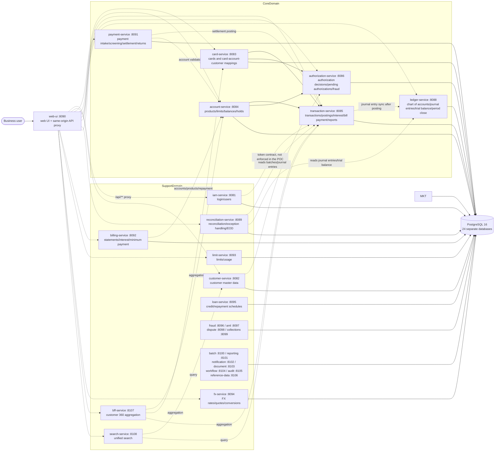

# CardDemo Java Microservices Edition (carddemo-java-1025)

Migrate AWS CardDemo (a CICS/COBOL credit card core demo system) into a Java microservices project built around **DDD bounded contexts**.
This project does not translate COBOL line by line; instead it first extracts existing business knowledge (the L1–L5 five-level model + the business rule catalog),
then splits 26 microservices along domain boundaries (6 existing business domains + general ledger, reconciliation, payment, billing, limit, FX, credit, risk, operations, and channel), and finally implements them with Spring Boot 3, providing a business-user-facing web UI and
Docker Compose debugging and run capability.

## 1. Architecture Overview



| Service | Port | Database | Corresponding legacy program |
|---|---|---|---|
| web-ui | 8090 → container 8080 | — (static SPA + proxy) | Corresponds to BMS screens (COSGN00C/COMEN01C/COADM01C, etc.) |
| iam-service | 8081 | `carddemo_iam` | COSGN00C, COADM01C, COMEN01C, COUSR00C–03C |
| customer-service | 8082 | `carddemo_customer` | CUSTDAT, CBCUS01C, COACTUPC (customer part) |
| card-service | 8083 | `carddemo_card` | CARDDAT, CCXREF, COCRDLIC/SLC/UPC |
| account-service | 8084 | `carddemo_account` | ACCTDAT, COACTVWC, COACTUPC (account part), CBTRN02C account segment, CBACT04C settlement, COBIL00C debit; adds product catalog, funds holds, and available credit |
| transaction-service | 8085 | `carddemo_transaction` | TRANSACT, DALYTRAN, TCATBALF, CBTRN01C/02C/03C, CBACT04C, COBIL00C, COTRN00C/01C/02C, CORPT00C, COTRTLIC; adds posting engine (types/rules/batches/reversals) |
| ledger-service | 8088 | `carddemo_ledger` | **New capability** (no general ledger in the legacy system): chart of accounts, double-entry journal entries, trial balance, period close |
| reconciliation-service | 8089 | `carddemo_reconciliation` | **New capability**: reconciliation of posting batches ↔ general ledger journal entries, exception handling, EOD job entry point |
| payment-service | 8091 | `carddemo_payment` | **New capability**: payment instruction intake, screening, settlement (posting), returns |
| billing-service | 8092 | `carddemo_billing` | **New capability**: statement generation, interest/minimum payment, bill payment |
| limit-service | 8093 | `carddemo_limit` | **New capability**: customer/account/channel limits, usage, and checks |
| fx-service | 8094 | `carddemo_fx` | **New capability**: FX rate maintenance, quotes, conversion records |
| loan-service | 8095 | `carddemo_loan` | **New capability**: loan applications, approval, disbursement, equal principal-and-interest schedules, repayment |
| fraud-service | 8096 | `carddemo_fraud` | **New capability**: fraud rule scoring, alerts, and case handling |
| aml-service | 8097 | `carddemo_aml` | **New capability**: sanctions/watchlist screening, AML alerts |
| dispute-service | 8098 | `carddemo_dispute` | **New capability**: dispute cases, provisional credit, chargeback |
| collections-service | 8099 | `carddemo_collections` | **New capability**: delinquency buckets, promise to pay, case closure |
| batch-service | 8100 | `carddemo_batch` | **New capability**: job definitions and EOD execution (interest accrual/reconciliation) |
| reporting-service | 8101 | `carddemo_reporting` | **New capability**: transaction summaries, trial balance reports |
| notification-service | 8102 | `carddemo_notification` | **New capability**: templates, notifications, and delivery status |
| document-service | 8103 | `carddemo_document` | **New capability**: document metadata, text content, archiving |
| workflow-service | 8104 | `carddemo_workflow` | **New capability**: process definitions, task approval/rejection |
| audit-service | 8105 | `carddemo_audit` | **New capability**: append-only audit events and search |
| reference-data-service | 8106 | `carddemo_reference` | **New capability**: currencies/countries/holidays/product categories |
| bff-service | 8107 | — (stateless) | **New capability**: customer 360 aggregation |
| search-service | 8108 | — (stateless) | **New capability**: unified customer/transaction search |
| authorization-service | 8086 | `carddemo_authorization` | COPAUA0C, COPAUS0C/1C/2C, CBPAUP0C, IMS PAUTSUM0/PAUTDTL1, DB2 AUTHFRDS |

## 2. Directory Structure

```
carddemo-java-1025/
├── pom.xml                      # Maven aggregator parent POM (Spring Boot 3.3.6 / Java 21)
├── docker-compose.yml           # PostgreSQL + 14 default microservices + web UI; the extended profile adds 12 more
├── docker/postgres/init/        # initialization of the 24 databases
├── scripts/build-and-up.sh      # package + build images + start
├── scripts/smoke-test.sh        # end-to-end smoke test
├── docs/
│   ├── legacy/                  # legacy knowledge: inventory, five-level model, rule catalog, data dictionary, glossary
│   ├── design/                  # DDD design: subdomains/contexts/decomposition/APIs/traceability matrix/ADRs
│   └── ops/                     # Docker runbook, security and performance hardening
└── services/
    ├── iam-service/
    ├── customer-service/
    ├── card-service/
    ├── account-service/
    ├── transaction-service/
    ├── ledger-service/           # general ledger: chart of accounts/journal entries/trial balance/period close (new)
    ├── reconciliation-service/   # reconciliation/EOD: batches↔journal entries, exception handling (new)
    ├── payment-service/          # payment: intake/screening/settlement/returns (new)
    ├── billing-service/          # billing: generation/interest/minimum payment/payment (new)
    ├── limit-service/            # limits: limits/usage/checks (new)
    ├── fx-service/               # FX: quotes/conversions (new)
    ├── loan-service/             # credit: application/approval/disbursement/repayment (new)
    ├── fraud-service/            # fraud scoring/alerts (new)
    ├── aml-service/              # sanctions screening/AML alerts (new)
    ├── dispute-service/          # disputes/chargeback (new)
    ├── collections-service/      # delinquency/collections (new)
    ├── batch-service/            # batch processing/EOD (new)
    ├── reporting-service/        # reports (new)
    ├── notification-service/     # notifications (new)
    ├── document-service/         # documents (new)
    ├── workflow-service/         # workflow (new)
    ├── audit-service/            # audit (new)
    ├── reference-data-service/   # reference data (new)
    ├── bff-service/              # customer 360 aggregation (new)
    ├── search-service/           # unified search (new)
    ├── authorization-service/
    └── web-ui/                  # business UI (static SPA) + same-origin API proxy
```

Except for `web-ui`, every Java microservice uses the same layering:

```
src/main/java/com/carddemo/<context>/
├── interfaces/rest   # Controller + DTO
├── application       # use case orchestration, transaction boundaries
├── domain            # aggregate roots, domain services, repository ports, exceptions
└── infrastructure    # JPA adapters, downstream REST clients, configuration
```

## 3. Quick Start

Prerequisites: JDK 21, Maven 3.9+, Docker + Compose v2.

```bash
git clone https://github.com/JeffyLiu003/carddemo-java-1025.git
cd carddemo-java-1025
./scripts/build-and-up.sh          # mvn package + docker compose up -d --build
docker compose ps
./scripts/smoke-test.sh            # end-to-end verification (health → login → query → posting → authorization → reports → payment/reconciliation → limit/FX/cashback → BFF/search)
```

Open **http://localhost:8090/** to reach the business UI (the login account is pre-filled, so you can sign in directly).

> Docker Hub is unreachable from the current environment, so images are built from the locally available `eclipse-temurin:21.0.8_9-jdk` and
> `postgres:16-alpine`; therefore `mvn package` must be run on the host before building images (the script already covers this).
> If your network can reach Docker Hub, change the first line of each service's `Dockerfile` to `eclipse-temurin:21-jre`
> and restore the multi-stage build.

All unit/integration tests:

```bash
mvn test        # 763 test cases, H2 + Flyway, multi-module in parallel
```

## 3.1 Web UI (Recommended)

Open **http://localhost:8090/** (port 8080 on the host is taken by another program, hence the mapping to 8090; inside the container it is still 8080).

| Page | Capability | Corresponding legacy screen/program |
|---|---|---|
| Login | Account pre-filled; switch between administrator and regular user | COSGN00C |
| Home | Shows available feature entries by role | COMEN01C / COADM01C |
| Account view | Combined account + customer + card display; product/limit/holds/available credit; create and release holds | COACTVWC |
| Posting | Posting types, idempotent batches, debit and credit entries, reversals (new in the money path) | New capability |
| General ledger | Chart of accounts, journal entries, trial balance, period close, manual entries (new in the money path) | New capability |
| Reconciliation and EOD | Daily reconciliation, exception details and handling, EOD job history (administrator, new in the money path) | New capability |
| Payment | Create payments, screening, acceptance, settlement, returns (new in P2) | New capability |
| Billing | Generate statements, view interest/minimum payment/due date, pay in full (new in P2) | New capability |
| Limit | Create/adjust limits, reserve/release, availability checks (administrator, new in P2) | New capability |
| FX | FX rate maintenance, quotes, execute conversions, conversion records (new in P2) | New capability |
| Customer 360 | BFF aggregates accounts/cards/customers/transactions/entitlements; unified search (new in P5) | New capability |
| Loan | Application, approve/reject, disbursement, repayment schedule, repayment (new in P3) | New capability |
| Risk | Fraud scoring/alerts, AML screening/alerts, disputes, collections (new in P3) | New capability |
| Operations | Batch processing, reports, notifications, documents, workflow, audit, reference data (new in P4) | New capability |
| Cards | Filter by account/customer, paging, details and maintenance (embossed name/status/expiry) | COCRDLIC / COCRDSLC / COCRDUPC |
| Transaction query | Filter by transaction ID prefix/card number/account, paging, details | COTRN00C / COTRN01C |
| Transaction entry | Linked type/category selection, full merchant details, auto-generated transaction ID | COTRN02C |
| Bill payment | Look up amount due → confirm → pay in full and show the new balance | COBIL00C |
| Transaction reports | Statistics for a date range, range totals, totals by card | CORPT00C / CBTRN03C |
| Authorization management | Pending authorization summary, details, mark as fraud, expiry cleanup | COPAUS0C/1C/2C, CBPAUP0C |
| User management | List, create, edit, delete (administrator only) | COUSR00C–03C |

| Demo account | Password | Type |
|---|---|---|
| `ADMIN001` | `admin123` | Administrator (pre-filled) |
| `USER0001` | `user1234` | Regular user |

The front end is a vanilla SPA with no build dependencies (`services/web-ui/src/main/resources/static`); all `/api/**` requests are
proxied same-origin by web-ui to the corresponding microservice, so the browser never deals with CORS. The UI does not display sensitive information: full card numbers are shown for demonstration only,
the SSN is always masked, and the CVV is never returned.

## 3.2 API Console (Swagger UI)

Each microservice's root path returns a 302 to its own Swagger UI, which can be used to debug APIs:

| Service | Swagger UI | OpenAPI |
|---|---|---|
| iam | http://localhost:8081/ | http://localhost:8081/v3/api-docs |
| customer | http://localhost:8082/ | http://localhost:8082/v3/api-docs |
| card | http://localhost:8083/ | http://localhost:8083/v3/api-docs |
| account | http://localhost:8084/ | http://localhost:8084/v3/api-docs |
| transaction | http://localhost:8085/ | http://localhost:8085/v3/api-docs |
| ledger | http://localhost:8088/ | http://localhost:8088/v3/api-docs |
| reconciliation | http://localhost:8089/ | http://localhost:8089/v3/api-docs |
| payment | http://localhost:8091/ | http://localhost:8091/v3/api-docs |
| billing | http://localhost:8092/ | http://localhost:8092/v3/api-docs |
| limit | http://localhost:8093/ | http://localhost:8093/v3/api-docs |
| fx | http://localhost:8094/ | http://localhost:8094/v3/api-docs |
| loan | http://localhost:8095/ | http://localhost:8095/v3/api-docs |
| fraud | http://localhost:8096/ | http://localhost:8096/v3/api-docs |
| aml | http://localhost:8097/ | http://localhost:8097/v3/api-docs |
| dispute | http://localhost:8098/ | http://localhost:8098/v3/api-docs |
| collections | http://localhost:8099/ | http://localhost:8099/v3/api-docs |
| batch | http://localhost:8100/ | http://localhost:8100/v3/api-docs |
| reporting | http://localhost:8101/ | http://localhost:8101/v3/api-docs |
| notification | http://localhost:8102/ | http://localhost:8102/v3/api-docs |
| document | http://localhost:8103/ | http://localhost:8103/v3/api-docs |
| workflow | http://localhost:8104/ | http://localhost:8104/v3/api-docs |
| audit | http://localhost:8105/ | http://localhost:8105/v3/api-docs |
| reference | http://localhost:8106/ | http://localhost:8106/v3/api-docs |
| bff | http://localhost:8107/ | http://localhost:8107/v3/api-docs |
| search | http://localhost:8108/ | http://localhost:8108/v3/api-docs |
| authorization | http://localhost:8086/ | http://localhost:8086/v3/api-docs |

The request body of the login endpoint `POST /api/v1/auth/login` already contains the demo account; endpoints for
transactions, authorization, bill payment, postings, and interest are also pre-filled with real demo data. OpenAPI descriptions are generated from code annotations.

> Note: Swagger UI is a **per-service** API console; the web UI (8090) is the unified entry point for business users.
> The POC does not enforce token validation (ADR-007), so both entry points should only be used on the local machine or an isolated network.

## 4. Key Business Scenarios (curl)

```bash
# login (administrator)
curl -s -X POST localhost:8081/api/v1/auth/login \
  -H 'Content-Type: application/json' \
  -d '{"userId":"admin001","password":"admin123"}'

# account / customer / card (combine into the legacy COACTVWC view)
curl -s localhost:8084/api/v1/accounts/00000000001
curl -s localhost:8082/api/v1/customers/000000001
curl -s localhost:8083/api/v1/cards/by-account/00000000001

# end-of-day posting (card 3344556677889900 → account 6)
curl -s -X POST localhost:8085/api/v1/postings -H 'Content-Type: application/json' -d '{
  "transactions":[{"transactionId":"0000000000000100","cardNumber":"3344556677889900",
  "typeCode":"01","categoryCode":"0001","source":"POS TERM","description":"Purchase",
  "amount":25.00,"originalTimestamp":"2026-10-25T10:15:00","merchantId":"800000001",
  "merchantName":"Smoke Test","merchantCity":"Springfield","merchantZip":"10001"}]}'

# authorization (account 1: limit 2020, outstanding 1940 → available 80)
curl -s -X POST localhost:8086/api/v1/authorizations -H 'Content-Type: application/json' -d '{
  "cardNumber":"0500024453765740","transactionAmount":50.00,
  "transactionId":"TXN000000000001","merchantName":"Corner Grocery"}'

# bill payment (pay in full)
curl -s -X POST localhost:8085/api/v1/bill-payments -H 'Content-Type: application/json' \
  -d '{"accountId":"00000000001","confirm":true}'

# transaction report (2026-09, closed interval)
curl -s "localhost:8085/api/v1/reports/transactions?startDate=2026-09-01&endDate=2026-09-30"

# posting (idempotent batch, account 6; CARD_PURCHASE = DR 1100 / CR 2100)
curl -s -X POST localhost:8085/api/v1/posting-batches -H 'Content-Type: application/json' -d '{
  "idempotencyKey":"demo-posting-0001","typeCode":"CARD_PURCHASE","accountId":"00000000006",
  "amount":25.00,"currency":"USD","description":"Demo purchase"}'

# general ledger trial balance (2026-10)
curl -s "localhost:8088/api/v1/trial-balance?period=2026-10"

# reconciliation (for the business date) and EOD
curl -s -X POST localhost:8089/api/v1/reconciliation-runs \
  -H 'Content-Type: application/json' -d '{"businessDate":"2026-10-26"}'
curl -s -X POST localhost:8089/api/v1/eod-runs \
  -H 'Content-Type: application/json' -d '{"businessDate":"2026-10-26"}'
```

## 5. Design Highlights

- **Bounded contexts first**: accounts and customers are no longer updated in the same transaction (legacy `COACTUPC` covered two
  aggregates on one screen); bill payment is orchestrated by transaction-service and executed by account-service, while the authorization context independently owns pending authorization summaries. See ADR-001/004.
- **Zero-padded string identifiers + BigDecimal**: `accountId` is 11 digits, `cardNumber` 16 digits, `customerId` 9 digits, and
  `transactionId` 16 digits; all amounts use `numeric(12,2)`. See ADR-002.
- **One database per service**: cross-database JOINs are forbidden and cross-domain access goes through REST only; a downstream 404 means "does not exist" and a 5xx/timeout means "cannot determine" (fail closed).
- **Optimistic locking instead of record locks**: `@Version` replaces `READ UPDATE` plus snapshot comparison, and conflicts return 409. See ADR-006.
- **Defect fixes** (all documented and tested): the CVV is no longer overwritten by card maintenance, expiring authorization cleanup releases the credit balance,
  available credit deducts both the account balance owed and authorization holds, and passwords are stored with PBKDF2. See `NR-*` in the rule catalog.
- **Posting and general ledger (new)**: posting batches generate debit and credit entries from type rules; account balance changes and entries share the same transaction, while general ledger synchronization is best effort;
  reversals create a reversing batch and keep the original record; the general ledger is idempotent on `(sourceType, sourceId)`, and the trial balance and period close are queryable.
  See `docs/design/11-money-path-slice-a2.md`.
- **Reconciliation and EOD (new)**: posting batches are matched entry by entry against general ledger `POSTING_BATCH` journal entries per business date,
  identifying missing entries, amount mismatches, and orphan entries; exceptions can be registered and handled; EOD triggers reconciliation and leaves a trail. See `docs/design/12-reconciliation-and-eod.md`.
- **Payments and billing (new)**: payment instruction intake → screening → acceptance → settlement (posting batch) → return (reversal);
  statements are generated per account/period, with interest and minimum payment calculated and full payment supported; limits and FX are separate services. See `docs/design/13-payments-billing-limits-fx.md`.

## 6. Documentation

| Entry point | Description |
|---|---|
| [docs/README.md](docs/README.md) | Full documentation index |
| [docs/legacy/02-five-level-model.md](docs/legacy/02-five-level-model.md) | L1–L5 business model (with evidence) |
| [docs/legacy/03-business-rule-catalog.md](docs/legacy/03-business-rule-catalog.md) | Business rule → implementation landing point → status |
| [docs/design/02-bounded-contexts.md](docs/design/02-bounded-contexts.md) | 26 bounded contexts |
| [docs/design/05-api-catalog.md](docs/design/05-api-catalog.md) | All API contracts and seed data |
| [docs/design/06-traceability-matrix.md](docs/design/06-traceability-matrix.md) | Where the 44 legacy programs went (general ledger/reconciliation/payment/billing are new capabilities) |
| [docs/design/09-scale-up-blueprint.md](docs/design/09-scale-up-blueprint.md) | Scale-up blueprint and phased roadmap |
| [docs/design/10-money-path-slice-a1.md](docs/design/10-money-path-slice-a1.md) | A1: account productization, holds, available credit |
| [docs/design/11-money-path-slice-a2.md](docs/design/11-money-path-slice-a2.md) | A2: posting engine, general ledger, trial balance, and front end |
| [docs/design/12-reconciliation-and-eod.md](docs/design/12-reconciliation-and-eod.md) | A1.4: reconciliation, exception handling, and EOD jobs |
| [docs/design/13-payments-billing-limits-fx.md](docs/design/13-payments-billing-limits-fx.md) | P2: payment, billing, limits, and FX |
| [docs/design/14-risk-credit-collections.md](docs/design/14-risk-credit-collections.md) | P3: credit, fraud, AML, disputes, collections, batch processing |
| [docs/design/15-operations-support.md](docs/design/15-operations-support.md) | P4: reports, notifications, documents, workflow, audit, reference data |
| [docs/design/16-channel-and-quality.md](docs/design/16-channel-and-quality.md) | P5/P6: BFF, search, portal, performance, chaos, and security |
| [docs/design/adr/README.md](docs/design/adr/README.md) | 11 architecture decisions |
| [docs/ops/01-docker-runbook.md](docs/ops/01-docker-runbook.md) | Docker debug runbook |

## 7. Known Limitations (POC Scope)

1. **Authorization is not enforced**: iam issues HMAC tokens, but validation on the resource side is left to a gateway (ADR-007);
   neither the web UI (8090) nor the service ports may be exposed to the internet.
2. **No distributed transactions**: bill payment/posting use "local transaction + synchronous call + idempotency key"; see ADR-005 for Saga/Outbox.
3. **Reports migrate the data semantics only**, not the 133-byte print layout; statements, branch migration, and MQ adapters are deferred.
4. **Seed data is normalized sample data**: the legacy ASCII data contains EBCDIC overpunch characters, so a real migration must decode it according to the data dictionary.
5. Concurrent authorization on a single account uses optimistic locking, so hot accounts need retries; load-test and partitioning plans are still to be added (open item U1).
6. **The general ledger is a new capability**: postings call it synchronously afterwards, failures only raise alerts (with an empty `ledgerEntryId`), and there is no Outbox retry yet;
   the trial balance aggregates movements and excludes opening balances; period close does not support reopening yet.
7. **Reconciliation is a new capability**: it currently only checks "posting batches ↔ general ledger journal entries" and the trial balance; comparing account balances with
   general ledger 1100 needs a per-account subledger mapping (not implemented). EOD currently orchestrates reconciliation only; interest accrual/billing/general ledger rollover are yet to be extended.
8. **Payments are demo-grade**: there are no real ISO 20022/SWIFT/ACH messages, settlement networks, or cut-offs; sanctions screening uses a hard-coded list.
9. **Billing/limits/FX are demo-grade**: statements are generated from the current account snapshot, with no historical cycles, late fees, or installments;
   limits are not yet wired into the authorization path; FX supports direct currency pairs only, with no triangulation or exposure management.
10. **P3/P4/P5 are demo-grade**: loan/fraud/AML/dispute/collections are single-aggregate state machines; batch processing is invoked synchronously with no scheduler;
    reports/notifications/documents/workflow/audit/reference data are lightweight implementations; search filters in real time with no OpenSearch index;
    the BFF aggregates serially, without parallelism or caching.
11. **Extended services do not start by default**: to limit memory, the 12 P3/P4 services live in the Compose `extended` profile and are started with
    `docker compose --profile extended up -d`; 16 containers run by default.
