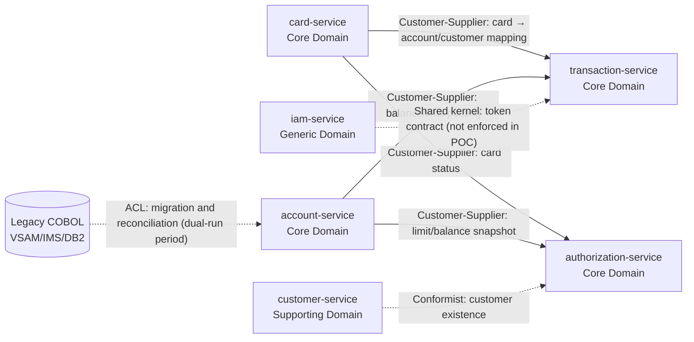

# Context Map

## 1. Mapping Relationships

| Upstream | Downstream | Relationship pattern | Integration style | Notes |
|---|---|---|---|---|
| Card | Transaction | Customer-Supplier | Synchronous REST `GET /cards/{cardNumber}` | Transactions need the card → account/customer mapping; Card keeps the contract stable |
| Account | Transaction | Customer-Supplier | Synchronous REST `GET/POST /accounts/...` | Account is the balance authority; transactions call the posting endpoint |
| Card | Authorization | Customer-Supplier | Synchronous REST | Authorization needs card status and account number |
| Account | Authorization | Customer-Supplier | Synchronous REST | Authorization reads limit/balance snapshots and does not write to the account |
| Customer | Authorization | Conformist | Synchronous REST | Only checks customer existence; authorization does not modify the customer |
| IAM | All services | Shared kernel (token contract only) | HTTP header (planned) | Not enforced during the POC phase (ADR-007) |
| Legacy COBOL system | New system | Anti-corruption layer (ACL, dual-run period) | Files/batch reconciliation | During migration, data is transformed by the migration tool; the new system never reads VSAM directly |
| Reporting (a submodule of Transaction) | Caller | Open Host Service (OHS) | REST report API | Read-only; never affects the write model in return |

## 2. Relationship Diagram

## 3. Integration Contract Principles

1. **Share DTOs only, never entities**: downstreams must not deserialize an upstream's JPA entities (a field change would break them in a chain).
2. **Upstreams are unaware of downstreams**: Account/Card do not know that Transaction/Authorization exist, and callbacks are forbidden.
3. **Uniform failure semantics**: `404` means "entity does not exist" (the downstream may translate it into a business decline); `5xx/timeout` means "cannot determine"
   (the downstream must fail closed and must not treat it as non-existent).
4. **Snapshot semantics**: the account balance read by authorization is a **point-in-time snapshot**, and the authorization summary evolves independently and locally (ADR-003/004).
5. **Anti-corruption layer**: legacy data (EBCDIC overpunch, fixed-length records) may only be decoded in the migration tool; new services never touch raw bytes.

## 4. Mapping to the Legacy System (ACL)

| Legacy concept | New concept | Transformation responsibility |
|---|---|---|
| `ACCT-CURR-BAL` | `Account.currentBalance` (amount owed) | Migration tool: decode overpunch → BigDecimal |
| `TRAN-CAT-BAL` | `TranCategoryBalance.balance` | Migration tool + posting service |
| IMS `PAUTSUM0/PAUTDTL1` | `PendingAuthorizationSummary` / `AuthorizationCase` | Migration tool: migrates only recent, non-expired authorizations |
| `AUTHFRDS` | `AuthorizationCase` (isomorphic) | Migration tool: one-to-one field mapping |
| Plaintext `SEC-USR-PWD` | `SecUser.passwordHash` (PBKDF2) | Force a password reset during migration or on first login |
| BMS screen fields | REST DTO + frontend | The frontend must be rebuilt; see `05-api-catalog.md` |

## 5. Evolution Direction

- Introduce an API gateway (ADR-007 option C): unified authentication, rate limiting and routing.
- Publish transaction events (`TransactionPosted`): reporting and notification switch to subscriptions, and the reporting service is deployed independently.
- Make limit holds between authorization and account event-driven (pre-authorization hold/release) to reduce synchronous dependencies.
